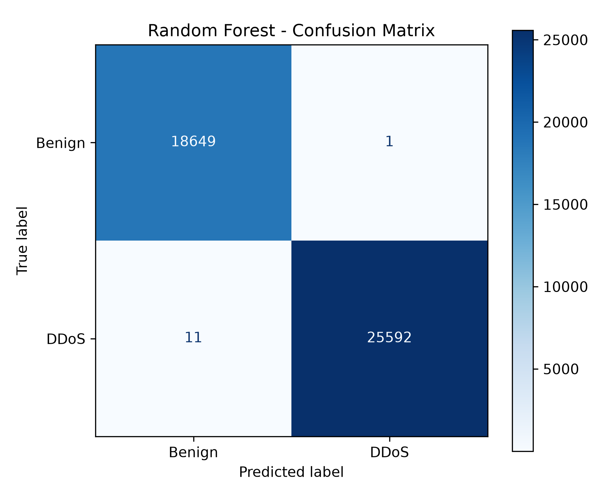
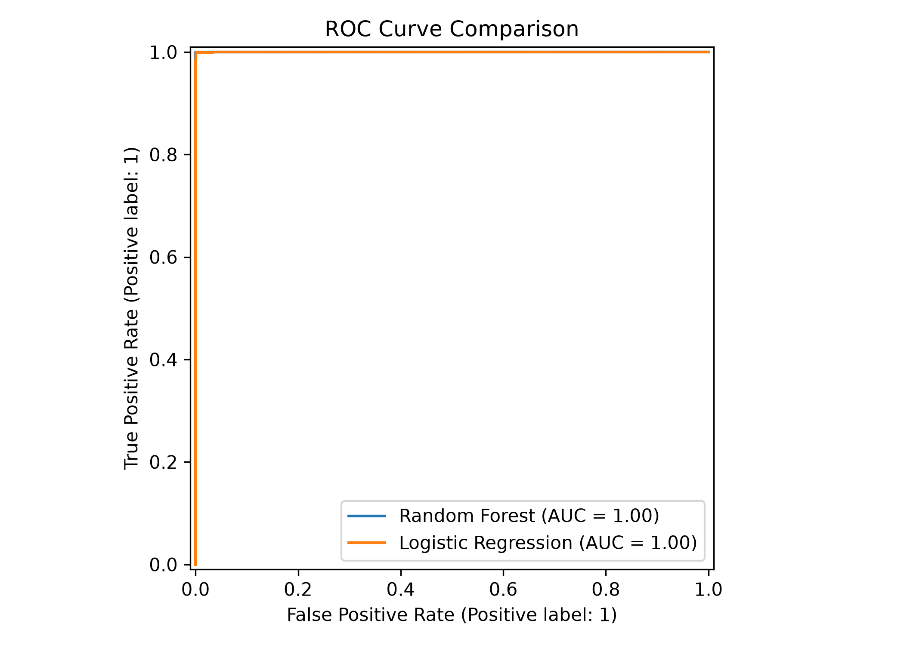

# NetSentinel: Explainable Network Anomaly & DDoS Detection System

NetSentinel is an end-to-end network intrusion and anomaly detection framework designed to classify high-volume network flows into **Benign** or **DDoS** traffic. Developed using statistical flow analysis and Machine Learning, the system incorporates Explainable AI (SHAP) to interpret model decisions and features an interactive web-based dashboard for single-flow inspection and batch CSV log scanning.

---

## Architecture Overview

`	ext
       +-------------------------------+
       | Network Flow Dataset (CIC-IDS)|
       +---------------+---------------+
                       |
                       v
         [ Data Cleaning & Preprocessing ]
         - Infinity & NaN removal
         - Drop zero-variance/constant features
         - Parquet format serialization
                       |
                       v
            [ Random Forest Classifier ]
            - Baseline evaluation (177k train / 44k test)
            - 99.97% test accuracy, 1.0000 ROC-AUC
                       |
         +-------------+-------------+
         |                           |
         v                           v
  [ Model Explainability ]   [ Real-Time Deployment ]
  - SHAP TreeExplainer       - Streamlit Dashboard
  - Gini Feature Importance  - Manual flow parameters
  - Packet size dynamics     - Batch CSV anomaly scanner
`

---

## Dataset & Preprocessing

- **Dataset Source:** CIC-IDS2017 DDoS / Benign network flow records.
- **Volume:** 221,262 total flow samples across 68 engineered network features.
- **Class Distribution:**
  - DDoS (1): 128,014 samples
  - Benign (0): 93,248 samples
- **Data Hygiene:**
  - Resolved inf and -inf values resulting from zero-time flow calculations.
  - Trimmed whitespaces from network header definitions.
  - Persisted intermediate artifact into optimized cleaned_ddos_flows.parquet.

---

## Model Performance & Evaluation

The baseline detector is built upon an ensemble **Random Forest Classifier** (
_estimators=100, 
andom_state=42) trained on an 80/20 stratified split.

### Classification Report (Test Set: 44,253 flows)

| Traffic Class | Precision | Recall | F1-Score | Support |
| :--- | :--- | :--- | :--- | :--- |
| **BENIGN (0)** | 0.9994 | 0.9999 | 0.9997 | 18,650 |
| **DDoS (1)** | 1.0000 | 0.9996 | 0.9998 | 25,603 |
| **Macro Average** | 0.9997 | 0.9998 | 0.9997 | 44,253 |
| **Weighted Average** | 0.9997 | 0.9997 | 0.9997 | 44,253 |

- **Overall Accuracy:** 99.97%
- **ROC-AUC Score:** 1.0000

---

### Model Benchmarking Comparison (44,253 Test Flows)

To evaluate the trade-off between detection accuracy and real-time inference latency, the Random Forest baseline was benchmarked against a regularized **Logistic Regression** classifier:

| Model Architecture | Accuracy | F1-Score | ROC-AUC | Batch Inference Time |
| :--- | :--- | :--- | :--- | :--- |
| **Random Forest (Baseline)** | **99.97%** | **0.9998** | **1.0000** | 131.6 ms |
| **Logistic Regression (Linear)** | 99.86% | 0.9988 | 0.9999 | **7.1 ms** |

- **Key Takeaway:** Random Forest delivers near-zero false positives for high-security offline/batch auditing, while Logistic Regression offers **~18.5x faster inference** (7.1 ms), making it ideal for ultra-low-latency edge filtering.

### Visual Evaluation Reports

| Confusion Matrix (Random Forest) | ROC Curve Comparison |
| :---: | :---: |
|  |  |

---

## Explainable AI (XAI) Findings

Using both **Gini Impurity reduction** and **SHAP (SHapley Additive exPlanations)** with TreeExplainer, model predictions were audited to verify that decisions rely on real attack signatures rather than dataset leakage:

1. **Fwd Packet Length Max & Avg Fwd Segment Size**: Primary indicators. DDoS attacks exhibit distinct volumetric and fixed packet-size distributions compared to variable-payload legitimate HTTP/DNS requests.
2. **Init Fwd Win Bytes**: Initial TCP forward window size captures aggressive, non-standard handshake behavior common in botnet traffic.
3. **Fwd IAT Total**: Flow Inter-Arrival Times indicate bursty, automated transmission intervals.

---

## Repository Structure

`	ext
netsentinel/
│
├── app/
│   └── streamlit_app.py         # Web dashboard for real-time & batch detection
├── data/
│   ├── raw/                     # Original source datasets (gitignored)
│   └── processed/               # Cleaned parquet flow files (gitignored)
├── models/
│   └── baseline_rf.joblib       # Trained Random Forest serialized model
├── notebooks/
│   ├── 01_eda.ipynb             # Exploratory Data Analysis & cleaning pipeline
│   └── 02_baseline_model.ipynb  # Model training, evaluation & SHAP analysis
├── reports/                     # Visualizations, charts, and audit plots
├── .gitignore                   # Excludes heavy binaries, venv, and large datasets
├── requirements.txt             # Project dependencies
└── README.md                    # Project documentation
`

---

## Quickstart & Installation

### 1. Prerequisites
- Python 3.10+
- Git

### 2. Environment Setup
`powershell
# Clone repository
git clone [https://github.com/Aaniket17/netsentinel.git](https://github.com/Aaniket17/netsentinel.git)
cd netsentinel

# Create and activate virtual environment
python -m venv venv
.\venv\Scripts\Activate.ps1

# Install dependencies
pip install -r requirements.txt
`

### 3. Launching Dashboard
Run the Streamlit application locally:
`powershell
streamlit run app/streamlit_app.py
`
Open your browser at http://localhost:8501 to access the interface.
